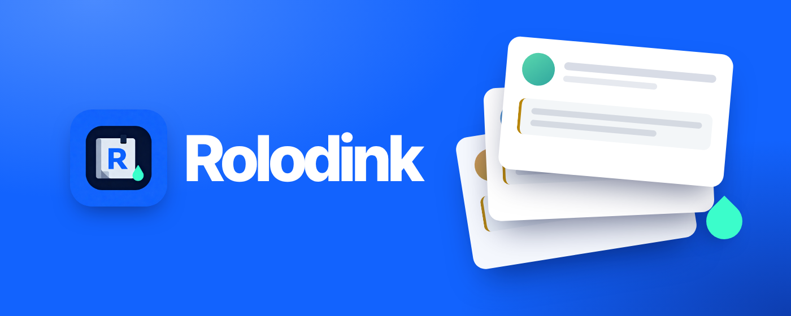
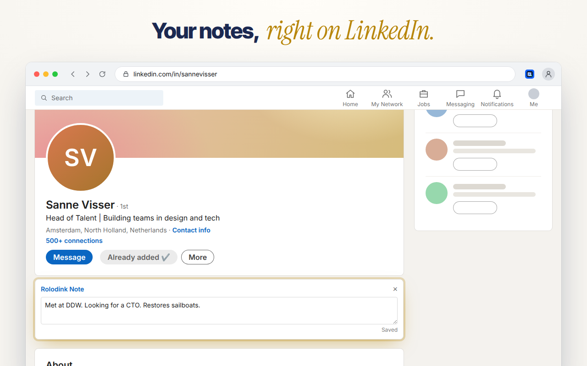
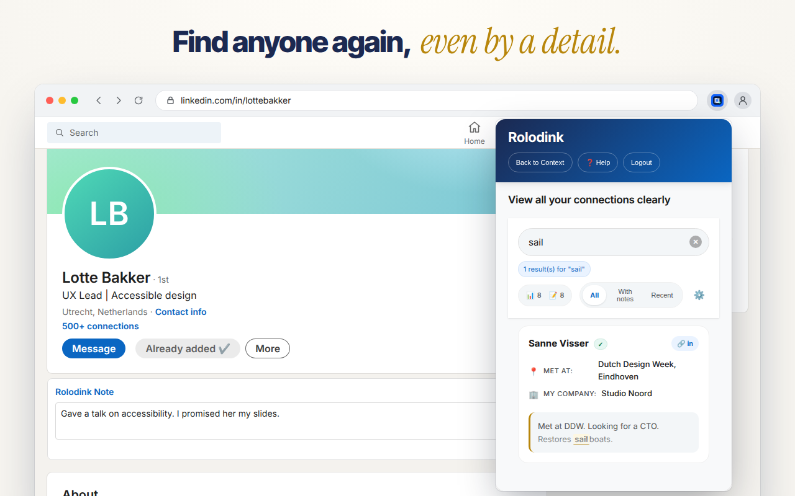
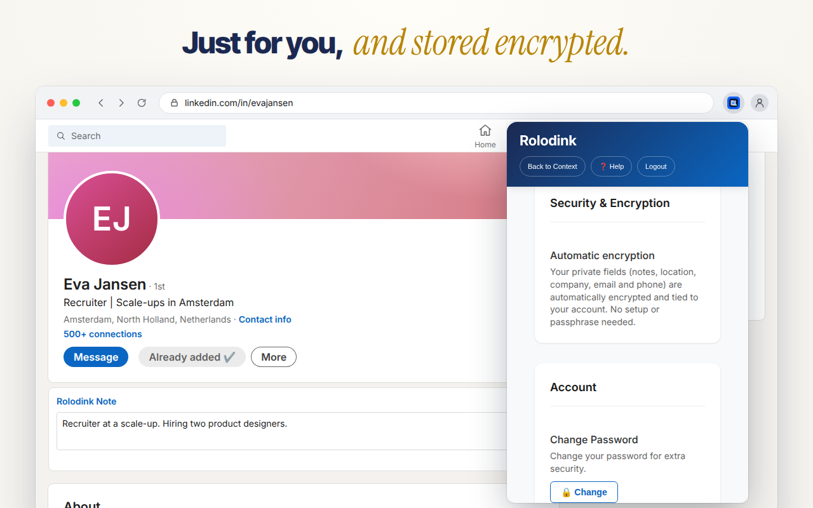

<p align="center">
  
</p>

<p align="center">
  <strong>Your private notes, right on LinkedIn.</strong><br>
  Remember where you met someone and what you talked about, without leaving their profile.
</p>

<p align="center">
  <a href="https://chromewebstore.google.com/detail/rolodink/jfgnbkeagmpmappmekainclghhndlimc"></a>
  <a href="https://microsoftedge.microsoft.com/addons/detail/rolodink/ihcocnphebdemiipmoedinojihpbcmmf"></a>
  <a href="https://addons.mozilla.org/en-US/firefox/addon/rolodink/"></a>
  <a href="https://github.com/thijsmat/rolodink/actions/workflows/github-flow.yml"></a>
</p>

<p align="center">
  <a href="https://rolodink.app">rolodink.app</a> ·
  <a href="https://rolodink.app/en/download">Download</a> ·
  <a href="https://rolodink.app/en/changelog">Changelog</a>
</p>

---

<p align="center">
  
</p>

## What it does

- **Notes on the profile.** A note card sits on every LinkedIn profile you have saved. Type, and it saves.
- **One click to save someone.** *Add to Rldnk* keeps their name and profile link. Add where you met, the company you were at then, and their email and phone.
- **Find people again.** The popup lists everyone you saved. Search covers names, notes, meeting place, company, email and phone.
- **Private by design.** Notes, meeting place, company, email and phone are encrypted in your browser before they are stored. The server never sees them in plain text.
- **Chrome, Edge and Firefox**, with one account across all three.

<p align="center">
  
  
</p>

## Install

| Browser | Store |
|---|---|
| Chrome | [Chrome Web Store](https://chromewebstore.google.com/detail/rolodink/jfgnbkeagmpmappmekainclghhndlimc) |
| Edge | [Edge Add-ons](https://microsoftedge.microsoft.com/addons/detail/rolodink/ihcocnphebdemiipmoedinojihpbcmmf) |
| Firefox (140 or later) | [Firefox Add-ons](https://addons.mozilla.org/en-US/firefox/addon/rolodink/) |

Each release also has the three packages as `.zip` under [Releases](https://github.com/thijsmat/rolodink/releases).

## How your notes are protected

Every account gets its own AES-256 data key. The backend stores it wrapped with a master key that never leaves the server, and hands it only to you, signed in. The extension uses that key to encrypt the private fields itself, so what reaches the database is ciphertext (`rolodink-enc:…`). If encryption fails, nothing is saved: there is no plaintext fallback.

## Repository

An npm-workspaces and Turbo monorepo on Node 22.

| Path | What |
|---|---|
| [`linkedin-crm-extension/`](linkedin-crm-extension) | The browser extension: React + Vite popup, background worker, content script on linkedin.com. One build, packaged for three browsers. |
| [`linkedin-crm-backend/`](linkedin-crm-backend) | API on Next.js 16 route handlers, Prisma on Supabase Postgres, deployed on Vercel (`fra1`). |
| [`website/`](website) | rolodink.app: Next.js 16 App Router, Dutch and English. |
| [`packages/core/`](packages/core) | Shared TypeScript: encryption, LinkedIn URL normalisation, conflict handling. |
| [`supabase/`](supabase) | Supabase Auth configuration and email templates, as code. |
| [`docs/`](docs) | Release process, release notes, store listings; older material in `docs/archive/`. |

## Development

```bash
npm ci --ignore-scripts
(cd linkedin-crm-extension/ui && npm ci --ignore-scripts)
npm run prisma:generate --prefix linkedin-crm-backend
```

```bash
npm test                                                          # backend + packages/core
(cd linkedin-crm-extension/ui && npm run typecheck && npm run lint && npm test)
(cd linkedin-crm-extension && node build.js chrome edge firefox)  # packages into dist/tmp/<browser>
(cd website && npm run lint && npm run build)
```

To try the extension, build it and load `dist/tmp/<browser>` unpacked. Only the Chrome package carries the key that matches the store ID, so LinkedIn sign-in only works unpacked in Chrome.

Changes go through a pull request to `main`; CI builds and checks all three browser packages. Releases are automated: see [`docs/RELEASE_PROCESS.md`](docs/RELEASE_PROCESS.md) and [`CHANGELOG.md`](CHANGELOG.md).

## Contact

Questions or feedback: [hello@rolodink.app](mailto:hello@rolodink.app) or the feedback button in the extension.
